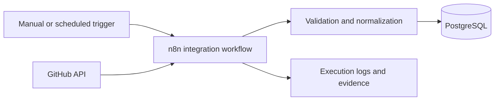

# Architecture

## Initial context

## Status

This is the initial architectural boundary, not the final design. Authentication, incremental state, failure handling and test strategy will be documented before workflow implementation begins.

