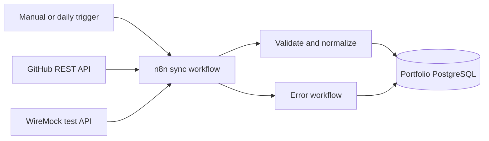
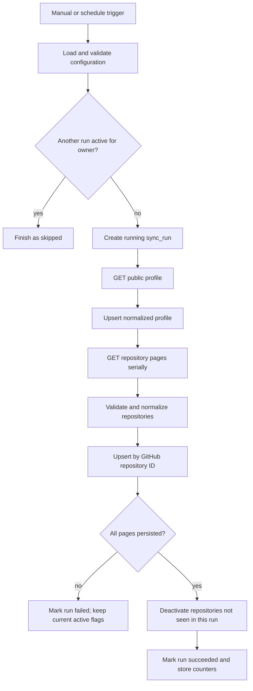

# Architecture — V1

## System context

## Components

| Component | Responsibility |
|---|---|
| Main n8n workflow | Start a run, call the API, paginate, normalize, persist, reconcile and finish the run |
| Error n8n workflow | Sanitize and persist operational failure context |
| GitHub REST API | Supply public profile and repository metadata |
| PostgreSQL | Persist the portfolio projection, run history and sanitized errors |
| WireMock | Reproduce success, pagination and failure responses without depending on the live API |

The GitHub native node is intentionally not used. The HTTP Request node makes headers, query parameters, status codes, pagination and rate-limit behavior observable.

## Main flow

## API contract

Base URL: `https://api.github.com`

| Purpose | Method and path | Query |
|---|---|---|
| Profile | `GET /users/{username}` | none |
| Repositories | `GET /users/{username}/repos` | `type=owner`, `sort=updated`, `direction=desc`, `per_page=100`, `page=N` |

Required request headers:

- `Accept: application/vnd.github+json`
- `Authorization: Bearer <credential managed by n8n>`
- `X-GitHub-Api-Version: 2026-03-10`

The workflow records safe diagnostic values from `x-ratelimit-limit`, `x-ratelimit-remaining`, `x-ratelimit-used`, `x-ratelimit-reset`, `x-github-request-id`, `retry-after` and `link`. Authorization headers and response bodies that may contain unexpected data are never copied into operational logs.

## Pagination and workload limits

- Requests are serial.
- Each page contains at most 100 repositories.
- Pagination stops when the response has no `rel="next"` link.
- `MAX_PAGES` defaults to 10 to prevent runaway execution and is configurable.
- Exceeding the configured limit fails the run; it never silently truncates the portfolio.
- The request timeout defaults to 30 seconds.

## Reconciliation and idempotency

Every execution creates a `sync_runs` record. Profile and repository rows are upserted by stable numeric GitHub IDs. Each repository receives the current `run_id` as `last_seen_run_id`.

Only after every page has been fetched, validated and persisted may the workflow set `is_active = false` for repositories belonging to the owner that were not seen in the current run. A partial or failed run may update records it already saw, but it must not deactivate any record. Re-running the same payload produces the same current-state projection and a new audit run, without duplicate profile or repository rows.

Only one run per owner may have status `running`. A concurrent trigger is recorded or reported as `skipped` instead of starting a second reconciliation.

## Data model

### `github_profiles`

- `github_user_id BIGINT PRIMARY KEY`
- `login TEXT NOT NULL`
- `name`, `bio`, `company`, `location`, `blog`, `html_url`, `avatar_url`
- `public_repos`, `followers`, `following`
- `github_created_at`, `github_updated_at`, `synced_at` as `TIMESTAMPTZ`

### `github_repositories`

- `github_repo_id BIGINT PRIMARY KEY`
- `owner_login`, `name`, `full_name`, `description`, `html_url`
- `language`, `topics JSONB`, `visibility`, `default_branch`
- `fork`, `archived`, `disabled`
- `stargazers_count`, `watchers_count`, `forks_count`, `open_issues_count`, `size`
- `github_created_at`, `github_updated_at`, `github_pushed_at`
- `first_seen_at`, `last_seen_at`, `last_seen_run_id`, `is_active`

### `sync_runs`

- identity `id`, `owner_login`, `started_at`, `finished_at`
- `status`: `running`, `succeeded`, `failed` or `skipped`
- counters: pages, received, inserted, updated and deactivated
- last safe request/rate-limit metadata
- sanitized `error_code` and `error_message`

### `sync_errors`

- identity `id`, `run_id`, `occurred_at`, workflow stage and node
- error category, HTTP status, request ID, attempt and retryable flag
- sanitized message without credentials or raw sensitive headers

## Normalization contract

- Required profile fields: `id` and `login`.
- Required repository fields: `id`, `name`, `full_name`, `owner.login` and `visibility`.
- Timestamps are stored as `TIMESTAMPTZ`.
- Blank optional strings become `NULL`; arrays default to `[]`; counts must be non-negative integers.
- Forks and archived repositories remain in the dataset and are represented by flags.
- An invalid required field fails the run and prevents deactivation.

## Failure policy

| Failure | Behavior |
|---|---|
| Missing or invalid credential (`401`) | Fail without retry; persist sanitized context |
| Forbidden without exhaustion (`403`) | Fail without automatic retry |
| Primary rate limit exhausted | Wait until `x-ratelimit-reset`, then retry |
| `retry-after` present | Wait for the supplied number of seconds, then retry |
| Secondary limit without `retry-after` | Wait 60, 120 and 240 seconds; then fail |
| Timeout, network error or `5xx` | Retry after 5, 15 and 45 seconds; then fail |
| Invalid payload | Fail without retry and identify the validation stage |
| PostgreSQL unavailable | Retry the database operation with bounded attempts; then fail |

There are at most three retries after the initial attempt. Repeated failures never enter an infinite loop.

## Deployment boundary

Docker Compose will start n8n, the portfolio PostgreSQL database and WireMock for tests. In V1, n8n may keep its own internal state in a persistent SQLite volume; moving n8n's internal database to PostgreSQL belongs to the later platform-focused project. Runtime image versions must be pinned when implementation begins.
